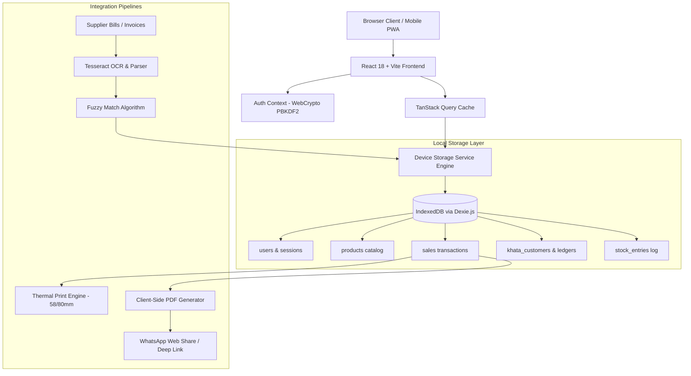

<div align="center">

# 📦 Inventory Blue Flow
### Enterprise-Grade In-Device Retail POS, Khata Ledger & AI Inventory Suite

[](https://react.dev/)
[](https://www.typescriptlang.org/)
[](https://vitejs.dev/)
[](https://dexie.org/)
[](https://tesseract.projectnaptha.com/)
[](https://tailwindcss.com/)
[](https://web.dev/progressive-web-apps/)

<p align="center">
  <strong>A modern, privacy-first, lightning-fast retail operating system built for shopkeepers, pharmacies, and small-to-medium retail stores.</strong><br>
  Zero cloud subscriptions. Zero internet dependencies. 100% data ownership on your own device.
</p>

[Key Features](#-key-features) • [System Architecture](#-system-architecture) • [Quick Start](#-quick-start) • [Default Credentials](#-default-credentials) • [Modules Guide](#-modules-guide) • [Security & Storage](#-security--storage)

---

</div>

## 🌟 Overview

**Inventory Blue Flow** is an enterprise-grade Progressive Web Application (PWA) designed to replace bulky, expensive ERP systems with a sleek, browser-native POS terminal, automated AI invoice scanning, and automated credit ledger (Khata).

All product catalogs, sales records, customer ledgers, and staff credentials reside securely inside your device's **IndexedDB** database using **Dexie.js**. The application works seamlessly without an internet connection, allowing shopkeepers in remote areas or high-volume counters to operate with sub-millisecond responsiveness.

---

## 🚀 Key Features

```
┌────────────────────────────────────────────────────────────────────────┐
│                        INVENTORY BLUE FLOW                             │
├───────────────────┬────────────────────┬───────────────────────────────┤
│  ⚡ POS Terminal   │  🤖 AI Bill Scan   │  📒 Customer Khata Ledger     │
│  • Touch cart grid│  • OCR extraction  │  • Split cash/credit payments │
│  • Barcode search │  • Fuzzy matching  │  • Aging buckets (0-60+ days) │
│  • Split payments │  • Atomic stock-in │  • WhatsApp 1-click reminders │
├───────────────────┼────────────────────┼───────────────────────────────┤
│  🧾 Thermal Print │  🔒 Offline Auth   │  💾 Data Protection           │
│  • 58mm/80mm slips│  • Web Crypto PBKDF2│  • Single-file JSON export    │
│  • Client-side PDF│  • Role-based access│  • 1-click database restore   │
│  • WhatsApp share │  • In-device sessions│ • Wipe clean slate anytime  │
└───────────────────┴────────────────────┴───────────────────────────────┘
```

### 1. 🤖 Automated AI Supplier Bill Scanner (Smart Stock-In)
- **Multi-Modal Document Capture**: Snap photos with mobile cameras (`capture="environment"`), upload bill images (PNG/JPG), or import PDF supplier invoices.
- **In-Browser OCR Pipeline**: Embedded `Tesseract.js` worker parses vendor headers, invoice numbers, billing dates, and itemized rows directly on-device.
- **Intelligent Inventory Matching**: Automatically matches recognized bill items against your existing local catalog using fuzzy token overlap (Jaccard similarity).
  - 🟢 **Exact Match (≥ 85%)**: Prepares to increment existing SKU stock.
  - 🟡 **Fuzzy Match (55% – 84%)**: Flags potential match with a one-click remapping dropdown.
  - 🔵 **New Product (< 55%)**: Proposes creating a new SKU record with an auto-calculated 25% retail markup.
- **Atomic Multi-Item Update**: Batch-updates product stock quantities and creates audit history entries in a single Dexie transaction.

### 2. ⚡ High-Speed Point of Sale (POS) Terminal
- **Instant Search & Touch Filters**: Filter products instantly by generic formula, brand name, category, or barcode.
- **Cart Management**: Real-time quantity steppers, max-stock guardrails, and quick order clearing.
- **Split Payment Flexibility**: Accepts **Full Cash**, **Digital Payment**, **Split Cash + Credit**, or **100% Credit (Udhaar)**.
- **Khata Auto-Routing**: If any sale balance is unpaid (`due_amount > 0`), the transaction is automatically appended to the customer's ledger profile.

### 3. 📒 Customer Khata (Credit Ledger) & Debt Recovery
- **Cumulative Credit Profiles**: Track lifetime purchases, total debt outstanding, and settlement histories per customer.
- **Aging Analysis Dashboard**: Real-time bucketing into **0–15 Days (Current)**, **16–30 Days (Due Soon)**, **31–60 Days (Aging)**, and **60+ Days (Overdue)**.
- **Instant Settlement Logging**: Record partial or full cash/bank payments with printable recovery receipts.
- **1-Click WhatsApp Reminders**: Direct deep-linking (`https://wa.me/<phone>?text=...`) delivers polite balance alerts and itemized debt summaries without saving contacts to your address book.

### 4. 🧾 Thermal Receipts & WhatsApp PDF Dispatch
- **Thermal Print Formatting**: Optimized for standard **58mm** and **80mm** ESC/POS mini thermal receipt printers directly from browser print dialogs.
- **Client-Side PDF Generation**: Uses `html2pdf.js` / `jsPDF` to compile crisp digital receipts featuring store branding, invoice numbers, tax calculations, and payment status badges.
- **Native Web Share Intent**: On smartphones and tablets, clicking "Send on WhatsApp" triggers the native device share sheet to attach the invoice document directly into WhatsApp chats.

### 5. 🛡️ 100% In-Device Security & Local Auth
- **Zero Cloud Leakage**: No external databases, Supabase cloud sync, or Firebase telemetry.
- **Cryptographic Password Storage**: Passwords hashed using standard Web Crypto API (`PBKDF2` with `SHA-256` and 100,000 iterations + unique cryptographic salts).
- **Persistent Local Sessions**: Tokens stored in device storage with automatic session validation and role-based permissions (`admin` vs `staff/cashier`).

---

## 🏗️ System Architecture



---

## ⚡ Quick Start

### Prerequisites
- [Node.js](https://nodejs.org/) v18.0.0 or higher
- [npm](https://www.npmjs.com/) or [bun](https://bun.sh/)

### Installation & Run

```bash
# 1. Clone the repository
git clone https://github.com/Ghulam-Mohiuddin007/inventory-blue-flow.git

# 2. Navigate to project root
cd inventory-blue-flow

# 3. Install dependencies
npm install

# 4. Launch local dev server
npm run dev
```

Open your browser at **`http://localhost:8080`** (or the port displayed in your terminal).

---

## 🔑 Default Credentials

The application initializes with secure offline credentials stored locally inside your browser:

| Role | Email / Identifier | Password | Access Level |
| :--- | :--- | :--- | :--- |
| **Store Owner (Admin)** | `admin@inventory.local` | `admin123` | Full access (Inventory, POS, Khata, Database Tools) |
| **POS Cashier (Staff)** | `cashier@inventory.local` | `staff123` | POS Terminal & Sales transactions |

> [!TIP]
> You can update your store profile, store name, and password directly within the application settings.

---

## 🛠️ Modules Guide

| Module | Route | Primary Functions |
| :--- | :--- | :--- |
| **Dashboard** | `/` | Store KPI metric cards (Total SKUs, Daily Sales, Khata Debt, Stock Value), quick launchpad, and database tools. |
| **Inventory Catalog** | `/inventory` | Product list, stock alerts, inline stock increments, delete safeguards, and **Scan Supplier Bill** modal. |
| **Point of Sale** | `/pos` | Touch-screen checkout terminal, barcode search, multi-item cart, cash/credit checkout, and instant receipt drawer. |
| **Customer Khata** | `/khata` | Credit ledger profiles, aging debt breakdown (0–60+ days), cash recovery logging, and WhatsApp reminder dispatch. |
| **Sales History** | `/sales` | Complete transaction audit logs, CSV exports, date range filters, and digital thermal invoice reprints. |
| **Stock Inward Logs** | `/stock-entries` | Historical audit trail of all manual and scanned supplier restock batches. |

---

## 💾 Security, Backup & Clean Slate

### Full Device JSON Backup
- Under **Database Tools** on the Dashboard, click **Export Database Backup** to download your complete store history (products, sales, ledgers, stock logs) into a single portable `.json` file.
- Move or restore your data on any device or browser by uploading your backup file with **Restore Backup File**.

### Zero Dummy Data Policy
- The system starts with a **clean slate**: zero mock products, fake sales, or dummy debtor accounts.
- If you ever want to wipe test data, use the **Delete All Dummy & Store Data** button in **Database Tools** to reset all tables to clean zero.

---

## 💻 Tech Stack

- **Framework**: [React 18](https://react.dev/) + [Vite](https://vitejs.dev/)
- **Language**: [TypeScript 5.5](https://www.typescriptlang.org/)
- **UI Components**: [shadcn/ui](https://ui.shadcn.com/) + [Radix UI](https://www.radix-ui.com/)
- **Styling**: [Tailwind CSS 3.4](https://tailwindcss.com/)
- **In-Device Database**: [Dexie.js](https://dexie.org/) (Client-side IndexedDB wrapper)
- **State & Caching**: [TanStack Query v5](https://tanstack.com/query/latest)
- **OCR Engine**: [Tesseract.js v7](https://tesseract.projectnaptha.com/)
- **Icons**: [Lucide React](https://lucide.dev/)
- **Date Handling**: [date-fns](https://date-fns.org/)
- **PDF Generation**: [html2pdf.js](https://ekoopmans.github.io/html2pdf.js/) & [jsPDF](https://github.com/parallax/jsPDF)

---

## 📜 Available Scripts

| Command | Action |
| :--- | :--- |
| `npm run dev` | Starts local Vite development server with Hot Module Replacement (HMR). |
| `npm run build` | Compiles optimized production bundle into the `dist/` folder. |
| `npm run lint` | Runs ESLint to check for code quality and formatting issues. |
| `npm run preview` | Previews the compiled production build locally. |

---

## 📱 Mobile & PWA Usage

1. Open the app in your mobile browser (**Google Chrome** on Android or **Safari** on iOS).
2. Tap the browser menu and select **"Add to Home Screen"** or **"Install App"**.
3. Launch **Inventory Blue Flow** directly from your home screen as a standalone, full-screen offline app.

---

<div align="center">

Made with care for retail entrepreneurs & independent shopkeepers worldwide.

**[Inventory Blue Flow](https://github.com/Ghulam-Mohiuddin007/inventory-blue-flow)** • Free, Local & Private

</div>
